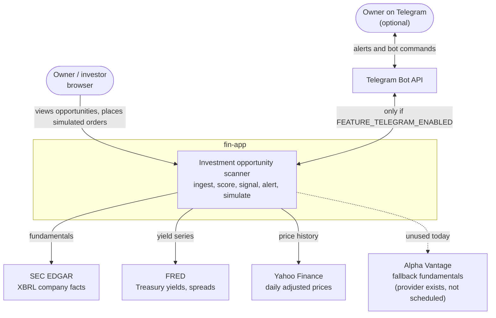
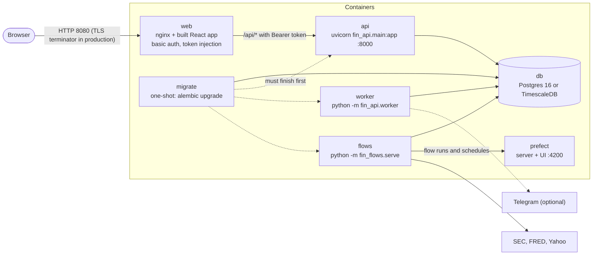

# 01: System context

## Context: people and systems

Nothing here executes real trades. The sandbox is a simulation, and alerts are the only outbound
product of the system.

## Containers

The compose files (`deploy/docker-compose.yml`, `deploy/docker-compose.prod.yml`) define these
services. The three Python images are built from one `deploy/python.Dockerfile`.

| Container | Role | Scales to |
| --- | --- | --- |
| `web` | Serves the SPA, enforces basic auth in production, adds the API token, rate-limits. | Stateless. |
| `api` | REST API: reads, scoring a ticker on demand, watchlist, alerts, sandbox writes. | Stateless; many replicas are safe. |
| `worker` | Delivery retries and the Telegram bot. Holds a Postgres advisory lock. | **Exactly one** (a second exits with status 3). |
| `flows` | Registers the schedules with Prefect and runs the daily pipeline. | One. |
| `prefect` | Prefect server and UI. Its image tag must equal the Prefect version locked in `uv.lock`. | One. |
| `migrate` | Applies Alembic migrations, then exits. | One-shot. |
| `db` | System of record. | One. |

The always-on minute-level loop planned for intraday polling is **not built**; it is meant to be a
separate service, not a Prefect job.
