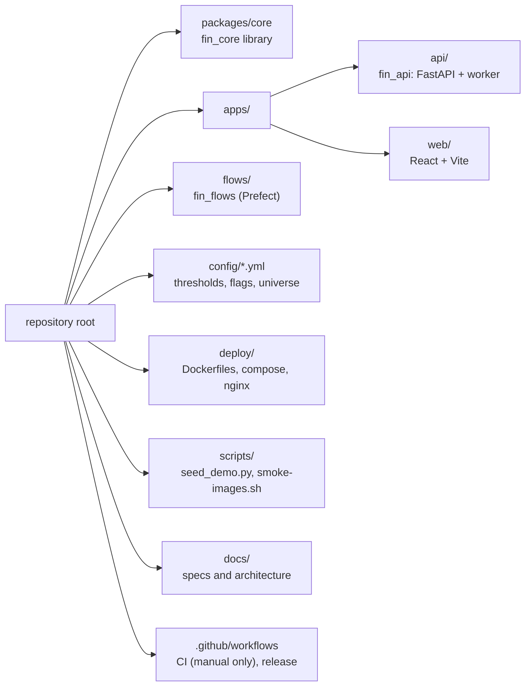
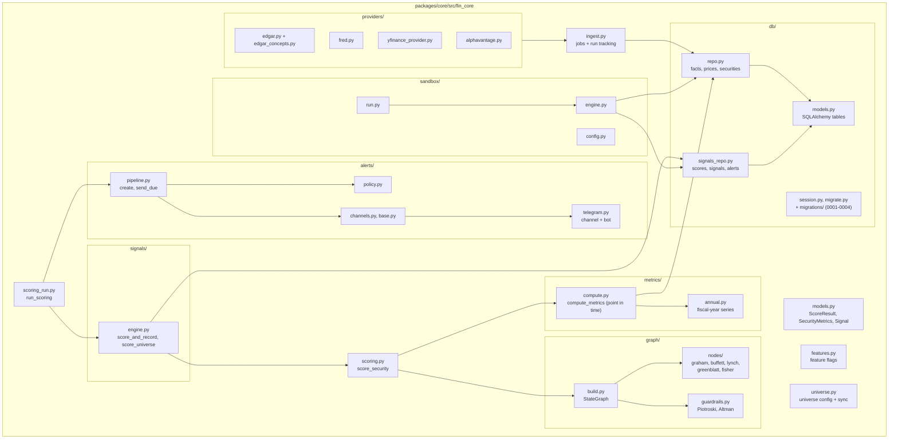
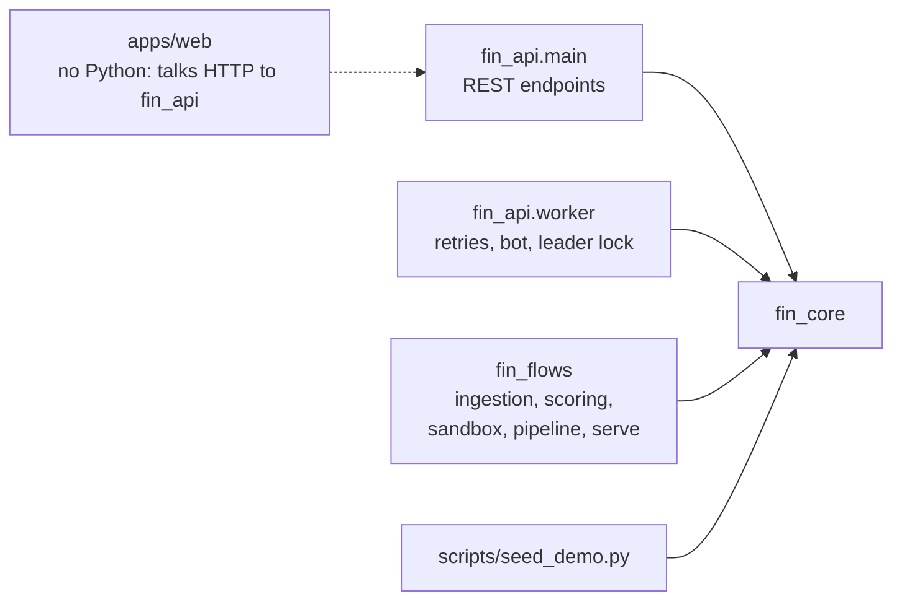

# 02: Repository map

## Layout

## `fin_core` packages

## Who uses `fin_core`

The rule behind the picture: **logic lives in `fin_core`; the apps only wire it to a transport**
(HTTP, Prefect, a long-running loop). `fin_flows` and `fin_api` never import each other.

## Configuration files

| File | Controls | Read by |
| --- | --- | --- |
| `config/philosophies.yml` | Thresholds and weights per philosophy, guardrails, `impl: deterministic \| llm`. | `graph.load_config` |
| `config/alerts.yml` | Cooldown, material change, sell-only-for-watchlist, retry backoff, severity. | `alerts.policy` |
| `config/sandbox.yml` | Strategy sizing defaults. | `sandbox.config` |
| `config/features.yml` | Feature flags (Telegram off). Env `FEATURE_<NAME>` overrides. | `features.FeatureFlags` |
| `config/universe.yml` | 15 stocks and 4 bond ETFs. | `universe` |
| `config/bond_series.yml` | FRED series ids (yields and spreads). | `universe.load_bond_series` (the yields flow) |

All are found by walking up parent directories from the module file, which is why the images copy
`config/` next to the virtual environment.

## Build and workspace

- Python: a `uv` workspace (`packages/core`, `apps/api`, `flows`), Python 3.12 or newer, one
  `uv.lock`, ruff for lint and format (line length 100), pytest.
- Web: `pnpm`, Vite, TypeScript, vitest with Testing Library.
- Releases: `cz.yaml` (Commitizen, Conventional Commits), `semver.sh`, `VERSION`, `CHANGELOG.md`.
