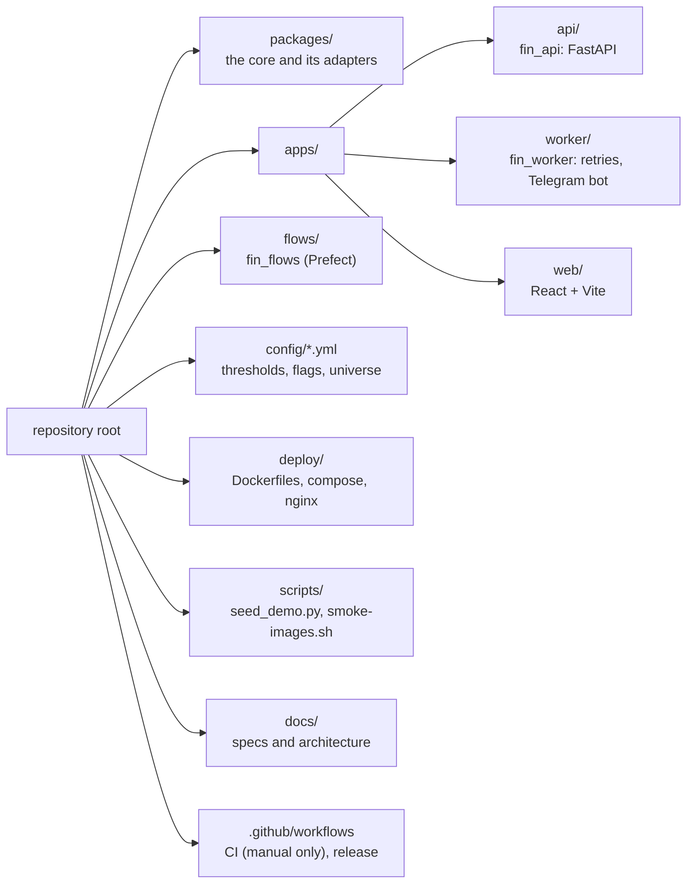
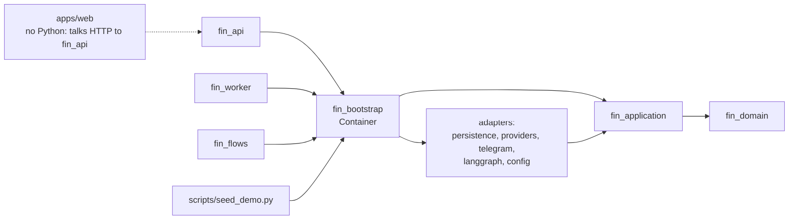

# 02: Repository map

## Layout

## Workspace packages

The domain and the application layer are the **protected core**; everything that touches the outside
world is an adapter behind a port. The picture and the rules are in [10](10-hexagonal-architecture.md).

| Package | Import name | Third-party deps | Role |
| --- | --- | --- | --- |
| `packages/domain` | `fin_domain` | none | Entities, value objects, pure rules, per bounded context: `shared`, `market_data`, `scoring`, `signals`, `sandbox`. |
| `packages/application` | `fin_application` | none | Use cases, DTOs, the **ports** (Protocols), application errors. |
| `packages/persistence` | `fin_persistence` | sqlalchemy, alembic, psycopg | Tables, migrations, repositories, `SqlUnitOfWork`, query services, `PgAdvisoryLeaderLock`. |
| `packages/providers` | `fin_providers` | httpx, pandas, yfinance | EDGAR, FRED, yfinance, Alpha Vantage clients. |
| `packages/telegram` | `fin_telegram` | httpx | `TelegramChannel` (driven) and `TelegramBot` (driving). |
| `packages/langgraph` | `fin_langgraph` | langgraph | `LangGraphScoringEngine`: the domain philosophies wired into a `StateGraph`. |
| `packages/config` | `fin_config` | pyyaml | One config locator, YAML loaders, `FeatureFlags`, universe files. |
| `packages/bootstrap` | `fin_bootstrap` | all adapters | `Settings` (the only reader of the environment), `Container` (the composition root), the migrate CLI. |
| `packages/testkit` | `fin_testkit` | none | In-memory fakes of every port. Tests only. |
| `apps/api` | `fin_api` | fastapi, uvicorn | HTTP only: routes, schemas, error mapping. |
| `apps/worker` | `fin_worker` | none extra | Delivery retries, bot loop, leader lock, exit codes. |
| `flows` | `fin_flows` | prefect | Thin Prefect wrappers over use cases. |

## Who uses what

The rule behind the picture: **rules live in `fin_domain`, orchestration in `fin_application`, I/O in
adapters; the apps only wire a transport (HTTP, Prefect, a long-running loop) to use cases** through
the container. `fin_flows`, `fin_api` and `fin_worker` never import each other or an adapter.

## Configuration files

| File | Controls | Read by |
| --- | --- | --- |
| `config/philosophies.yml` | Thresholds and weights per philosophy, guardrails, `impl: deterministic \| llm`. | `fin_config` |
| `config/alerts.yml` | Cooldown, material change, sell-only-for-watchlist, retry backoff, severity. | `fin_config` |
| `config/sandbox.yml` | Strategy sizing defaults. | `fin_config` |
| `config/features.yml` | Feature flags (Telegram off). Env `FEATURE_<NAME>` overrides. | `fin_config.FeatureFlags` |
| `config/universe.yml` | 15 stocks and 4 bond ETFs. | `fin_config` |
| `config/bond_series.yml` | FRED series ids (yields and spreads). | `fin_config` (the yields flow) |

`fin_config` finds them by walking up parent directories from its own module (or `FIN_CONFIG_DIR`),
which is why the images copy `config/` next to the virtual environment.

## Build and workspace

- Python: a `uv` workspace (the packages above, `apps/api`, `apps/worker`, `flows`), Python 3.12 or
  newer, one `uv.lock`, ruff for lint and format (line length 100), pytest, import-linter.
- Web: `pnpm`, Vite, TypeScript, vitest with Testing Library.
- Releases: `cz.yaml` (Commitizen, Conventional Commits), `semver.sh`, `VERSION`, `CHANGELOG.md`.
