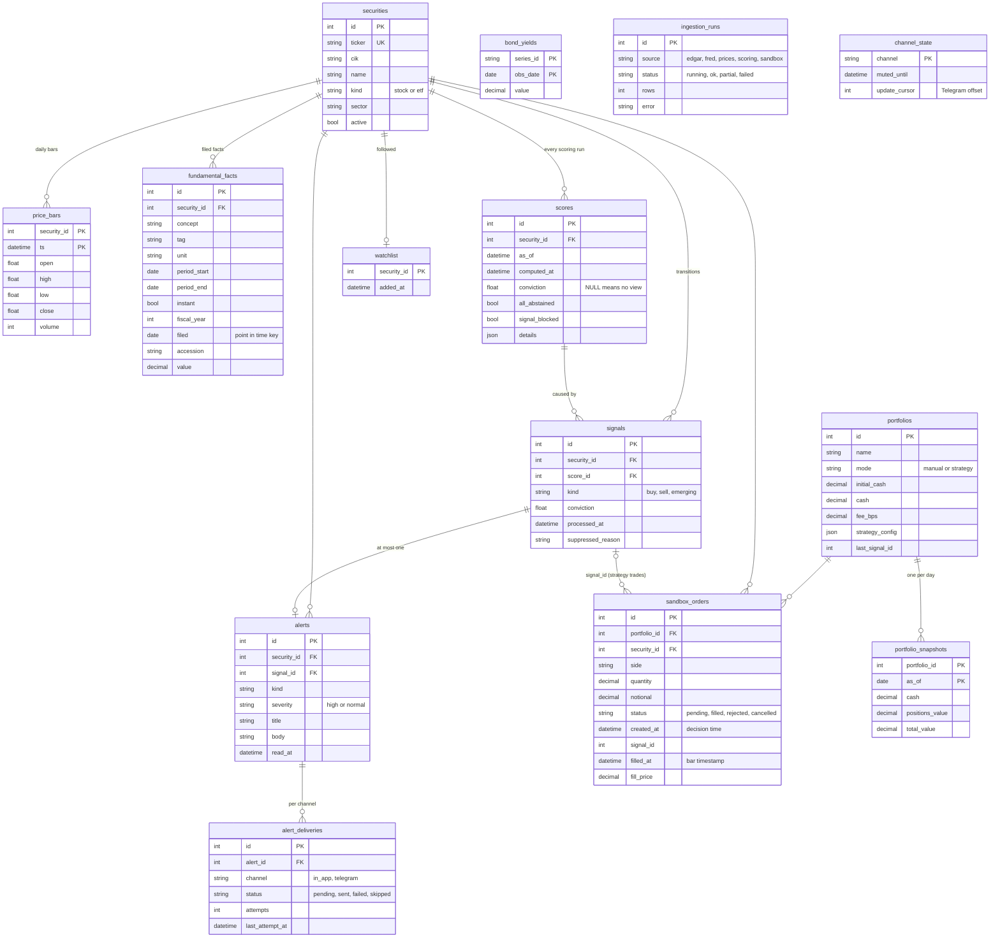

# 03: Data model

Fifteen tables in four groups, created by four hand-written Alembic migrations
(`0001` data layer, `0002` signals and alerts, `0003` delivery backoff and signal processing,
`0004` sandbox). The models must stay in sync with the migrations (a test asserts it). Code runs on
Postgres (production) and SQLite (fast tests); JSON columns are JSONB on Postgres.

## Entity relationships

`bond_yields`, `ingestion_runs` and `channel_state` have no foreign keys. Holdings are **not** a
table: they are derived from filled orders (see [06](06-sandbox.md)).

## Rules that shape the schema

| Rule | Where it shows up |
| --- | --- |
| **Point in time.** `fundamental_facts` keeps *every filed version* of a fact with its `filed` date. `repo.facts_as_of(as_of)` returns only what was public then, so a restatement is invisible until it was filed. | `fundamental_facts.filed` |
| **No NULLs in natural keys.** Instant facts (balance-sheet items) store `period_start == period_end`. | de-duplication and idempotent upserts |
| **Append-only history.** Every scoring run is kept; nothing is overwritten. | `scores` (retention policy is on the backlog) |
| **No view is not zero.** A run where nothing could be evaluated stores `conviction = NULL`. | `scores.conviction` |
| **Baselines skip bad runs.** The next transition is judged against the last score with a conviction that was not computed on stale or missing data. | `scores.signal_blocked`, `signals_repo.latest_actionable_score` |
| **Signals are processed exactly once.** `processed_at` marks a decided signal; `suppressed_reason` records a deliberate "no alert". | `signals` |
| **One alert per signal, one delivery per channel.** Unique `signal_id` on alerts; unique `(alert_id, channel)` on deliveries. | idempotent delivery |
| **A channel enabled later never replays history.** Delivery rows exist only for channels registered when the alert was created. | `alert_deliveries` |
| **Prices are adjusted, not as-traded.** The source re-adjusts old bars after a split; ingestion re-fetches the whole history if it detects it. | `price_bars` |
| **TimescaleDB is optional.** `price_bars` becomes a hypertable only when the extension exists. | migration `0001` |
| **UTF-8 database.** SQL_ASCII makes psycopg 3 return bytes. | deployment |
