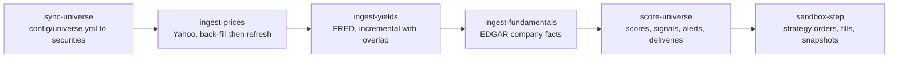
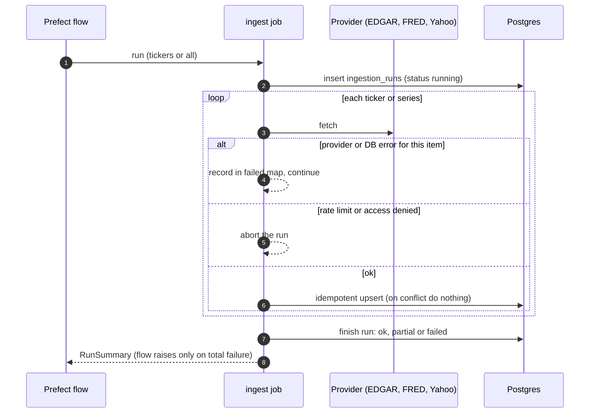
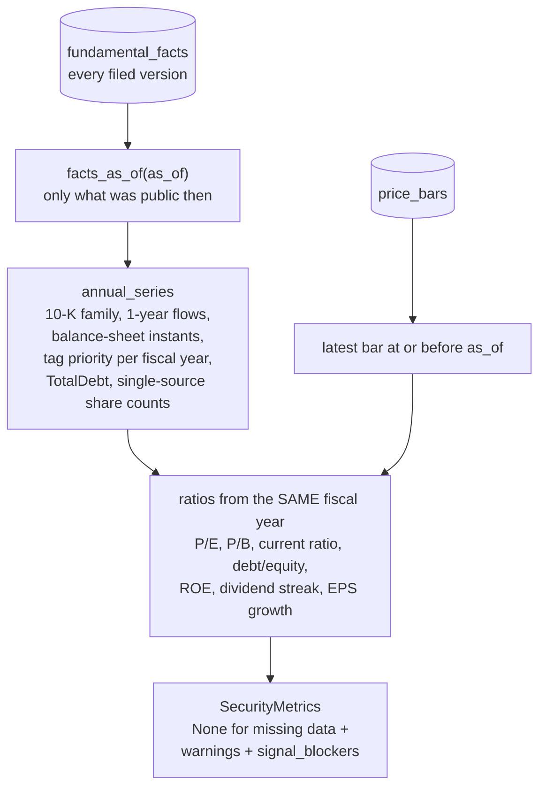
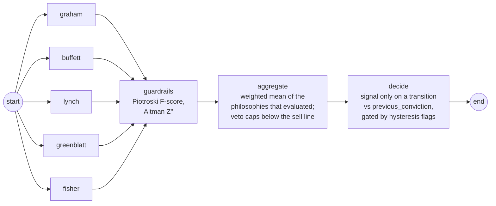
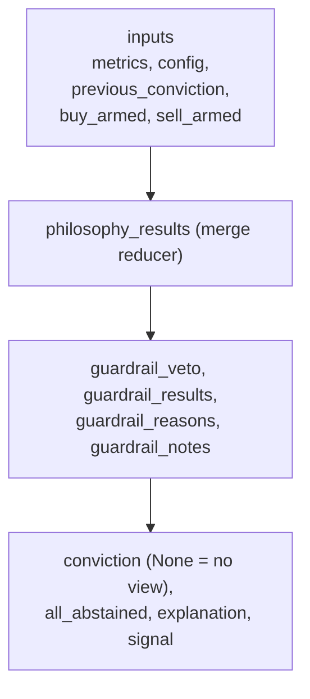
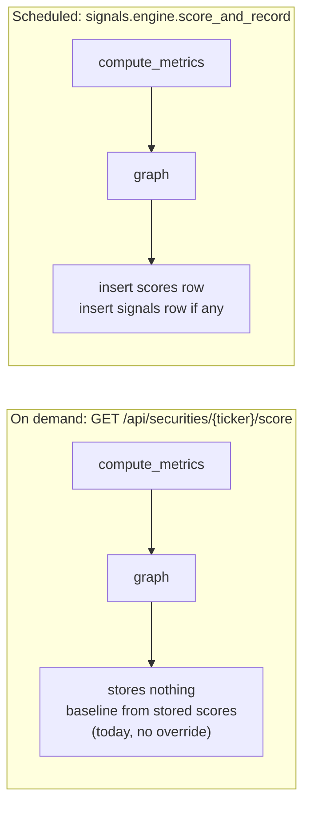

# 04: Data pipeline and scoring

## The daily pipeline

One scheduled Prefect deployment, `daily-pipeline`, runs weekdays at 21:30 UTC (after the US close).
Each step is also deployable by hand. A failing step does not stop the later ones (scoring copes with
stale data through its blockers); the flow fails at the end naming the failed steps.

Every job writes an `ingestion_runs` row. Statuses: a run is `failed` until it completes normally;
one bad ticker or series makes it `partial`; a rate-limit or access-denied response aborts it
(`failed`); stale `running` rows are failed by the next run.

## From facts to metrics (point in time)

`signal_blockers` (no or stale price, no or stale fundamentals) make the graph withhold buy and sell
signals while still reporting the score. Multi-class issuers (for example BRK-B) get no book value
or P/B.

## The scoring graph (LangGraph)

| Node | What it does | Abstains when |
| --- | --- | --- |
| `graham` | P/E, P/B, P/E×P/B, current ratio, debt/equity, dividend years, earnings growth. | Never abstains; non-positive P/E, P/B and negative debt/equity fail explicitly. |
| `buffett` | Durable ROE, operating margins, positive earnings, debt payback, capex intensity, margin of safety on owner earnings. | Fewer than 5 fiscal years; Financials. |
| `lynch` | Category by EPS growth (fast grower, stalwart, slow grower), dividend-adjusted PEG. | Cyclicals and turnarounds; Financials. |
| `greenblatt` | Earnings yield and return on capital against **absolute** thresholds. | Financials, Utilities, multi-class issuers, no operating income, no price or share count. |
| `fisher` | Quantifiable subset of his 15 points (growth, margins and trend, R&D intensity, dilution). Missing R&D fails as "no data". | Too little revenue history. |
| `guardrails` | Piotroski and Altman **cap** conviction below the sell line; they never add to it. A distress zone is a note, not a veto, for visibly profitable, cash-generative firms. | Financials, or too few evaluable signals. |

All five philosophies have equal weight (`config/philosophies.yml`). A node returns the same
`ScoreResult` contract whatever implements it, so a deterministic node can later be replaced by an
LLM-agent node (`impl: llm`) without touching this wiring.

**If every node abstains, conviction is `None` (not 0.0) and no signal is emitted**, so missing data
can never look like a collapse and trigger a sell.

### Graph state

## Two ways to score

The scheduled path is the system of record; the live path is a read-only preview that uses the same
baseline and hysteresis, so it only reports a signal when a transition has happened since the last
stored score.
