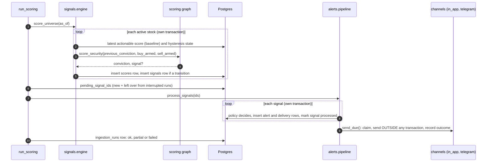
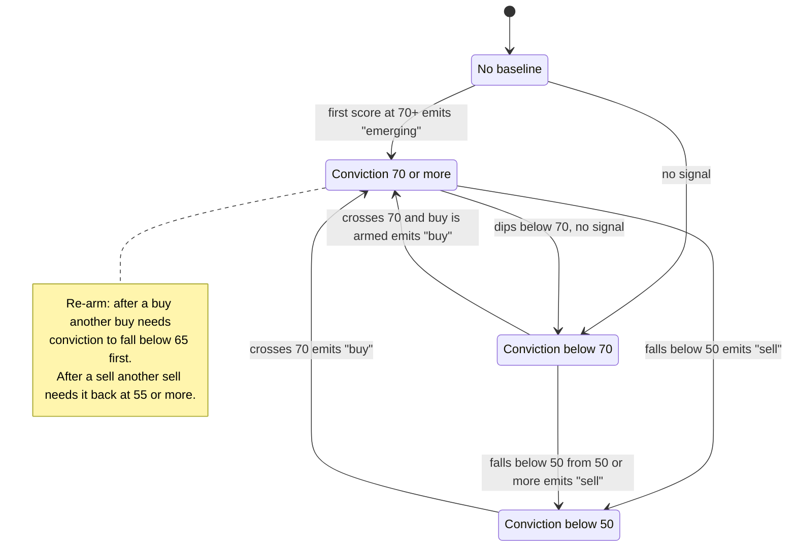
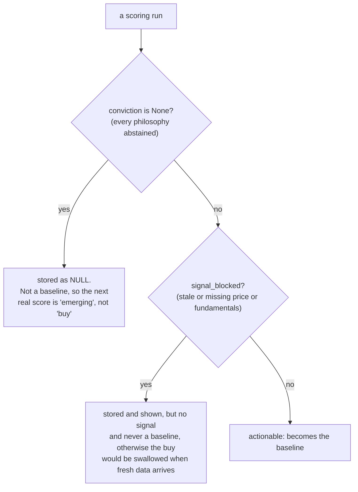
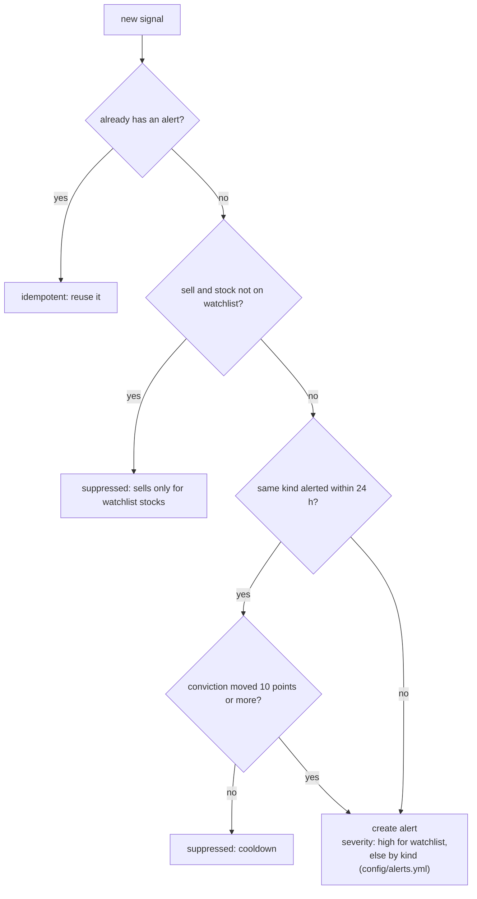
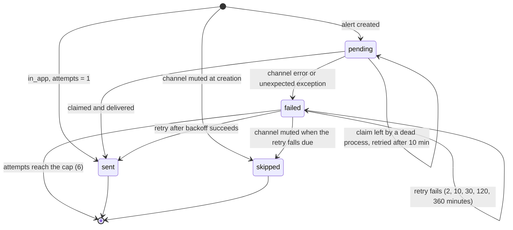
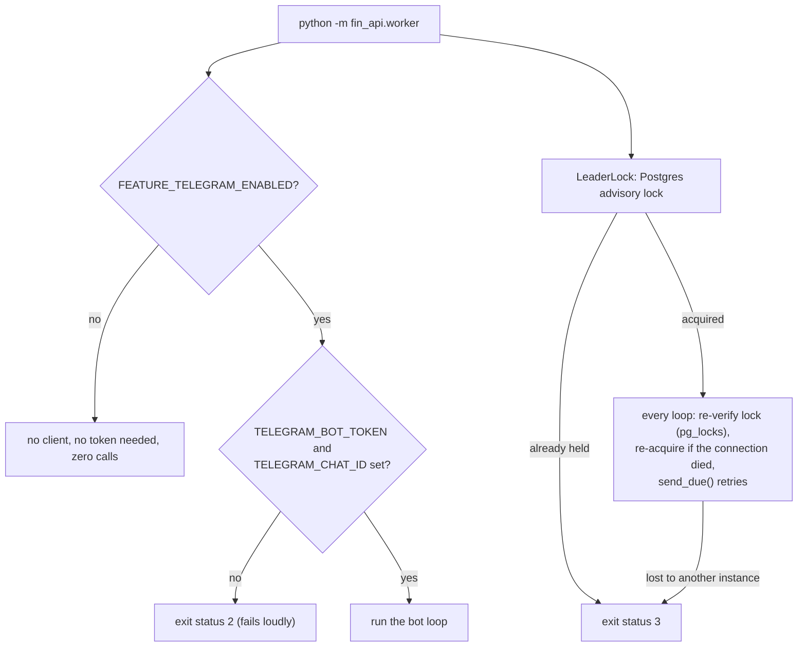

# 05: Signals and alerts

## The scheduled scoring run

## Signal state machine

A signal is emitted only on a **transition** relative to the last actionable stored score, never on
every run. Hysteresis stops a score flapping around a line from signalling repeatedly.

What does **not** move the baseline:

## Alert policy

A suppressed signal is still marked processed (with a `suppressed_reason`), so the recovery sweep never
re-alerts it.

## Delivery

Creating an alert writes its delivery rows in the **same transaction**. Sending happens afterwards.

Safety properties:

- **Claim by compare-and-set** on `attempts` (`claim_delivery`), so the scoring run and the worker can
  both call `send_due` and a delivery is still attempted by exactly one of them.
- **HTTP never runs inside a DB transaction**; each outcome is recorded in its own short transaction.
- A channel exception never escapes: `ChannelError` text is recorded, any other exception by type only.
- **No replay:** a channel enabled later has no delivery rows for older alerts.

## The worker and the Telegram bot

The bot answers only the configured chat. Its update offset is persisted **before** each command runs
(at-most-once), so a failing reply or a restart never replays `/mute` or `/unwatch`. The bot token is
part of every request URL, so it is kept out of errors and logs. **Telegram has only run against a
mocked Bot API.**
