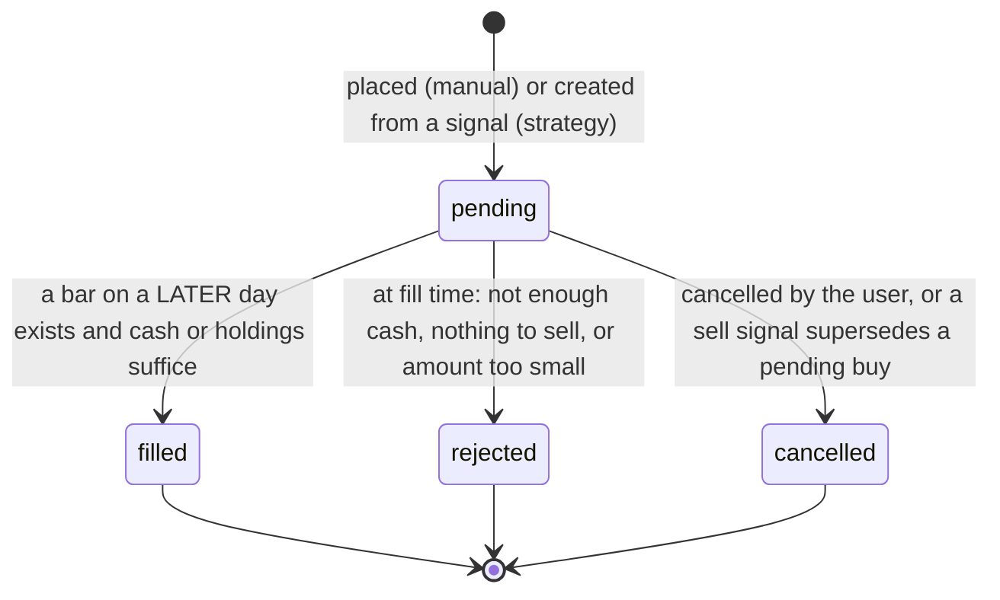
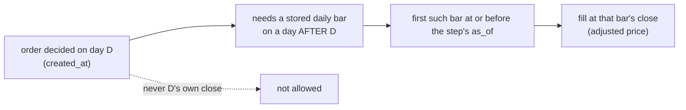
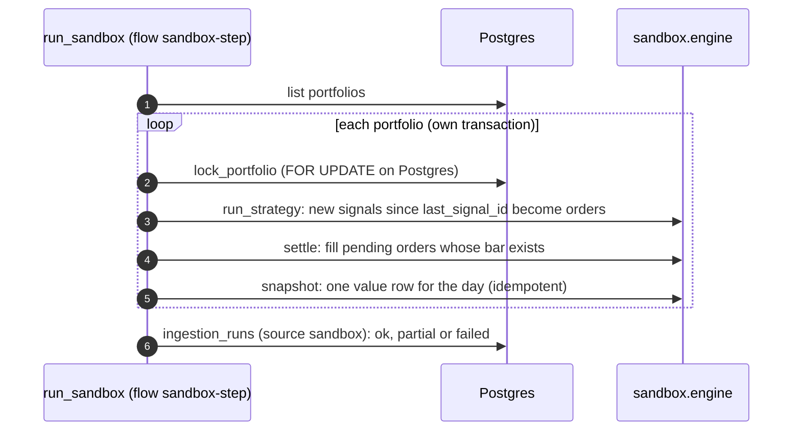
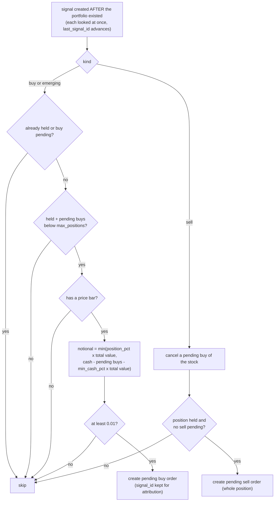
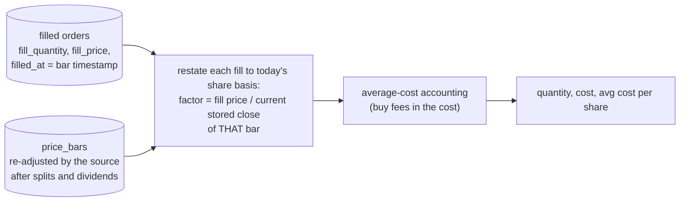

# 06: Paper-trading sandbox

A simulation: nothing here touches a broker. Two kinds of portfolio share one engine
(`fin_core/sandbox/engine.py`).

## Order lifecycle

## Fill model (no look-ahead)

Within one close, sells settle before buys, so a sale can fund a purchase. Cash and holdings are
checked **at fill time**. Fees (`fee_bps`) reduce cash and are part of the cost basis.

## The daily sandbox step

## Strategy portfolios

Deliberate rules: a skipped buy is **not** reconsidered (the signal was consumed), and cancelling a
strategy-created order does not re-place it. Defaults come from `config/sandbox.yml`:
`position_pct` 0.20, `max_positions` 5, `min_cash_pct` 0.05, `buy_kinds` buy and emerging, `fee_bps` 0.

## Holdings are derived, not stored

The price source re-adjusts history after a corporate action (ingestion re-backfills), so the ratio is the
cumulative adjustment since the fill. With no corporate action the factor is exactly 1. A 2:1 split
turns 1 share at 100 into 2 shares at 50 (no phantom loss); dividends appear as slightly more shares,
like reinvested dividends.

## Known limits

Daily adjusted prices only; no intraday execution, shorting, limit orders, cash interest or benchmark.
Strategy P&L on the demo database is invented, because the demo prices are synthetic.
