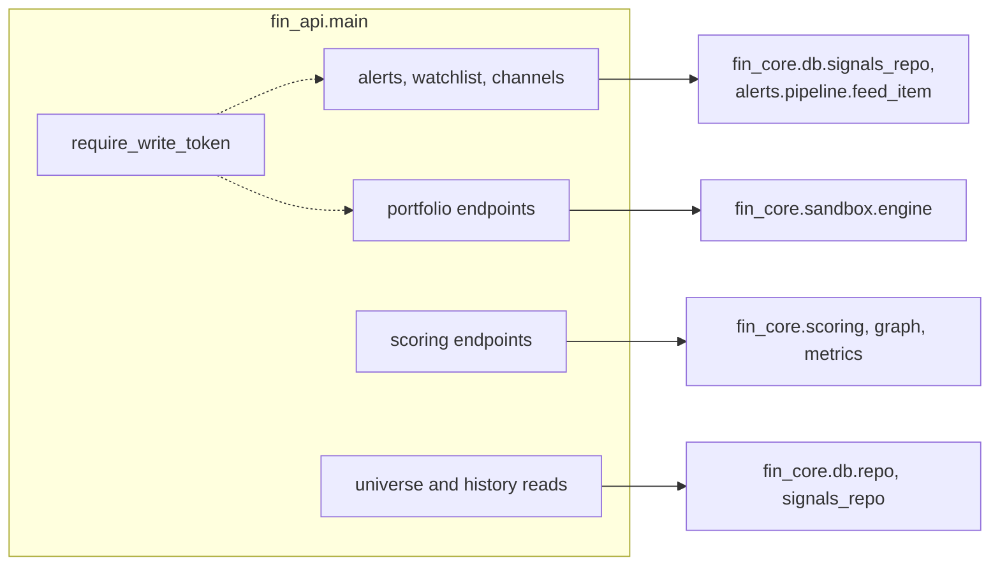
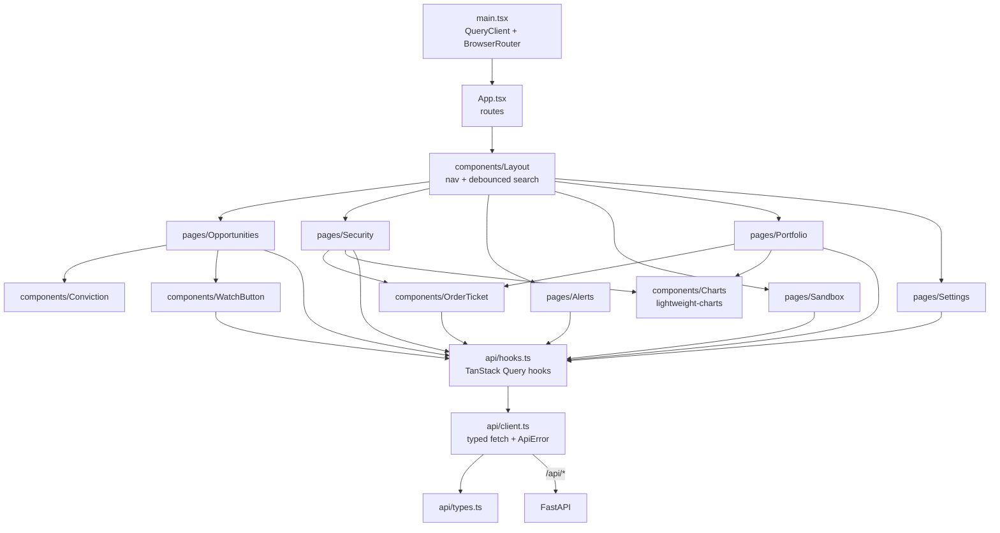
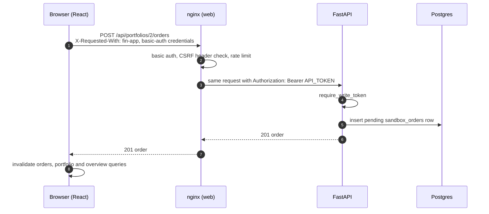

# 07: API and web UI

## REST API (`apps/api/src/fin_api/main.py`)

| Group | Endpoint | Auth | Notes |
| --- | --- | --- | --- |
| Health | `GET /healthz` | none | Liveness: the process is up. |
| | `GET /readyz` | none | Config and graph load; DB check when configured (503 if unreachable, no connection details). |
| Features | `GET /api/features` | open | Feature flags (read-only). |
| Scoring | `POST /api/score` | open | Score caller-supplied metrics. |
| | `GET /api/securities/{ticker}/score` | open | Score a stored ticker live. For today, the signal is judged against the stored baseline and hysteresis. 404 unknown, 422 future `as_of`. |
| Universe | `GET /api/securities` | open | Search by ticker prefix or name (matched literally), sector, kind; flags the watchlist. |
| | `GET /api/securities/{ticker}/prices` | open | Daily adjusted bars, merged into candles beyond `max_points`. |
| | `GET /api/securities/{ticker}/scores` | open | Stored score history (gaps flagged) and signal markers. |
| | `GET /api/opportunities` | open | Latest actionable score per stock, ignoring scores older than `max_age_days` (default 10). |
| Watchlist | `GET /api/watchlist` | open | |
| | `PUT`/`DELETE /api/watchlist/{ticker}` | **token** | |
| Alerts | `GET /api/alerts` | open | Cursor paging, unread filter; deliveries per channel. |
| | `POST /api/alerts/{id}/read` | **token** | |
| | `GET /api/channels` | open | Which channels are on; Telegram mute state. |
| Sandbox | `GET /api/portfolios`, `/{id}`, `/{id}/history`, `/{id}/orders` | open | Positions are derived; equity curve from snapshots. |
| | `POST /api/portfolios` | **token** | |
| | `POST /api/portfolios/{id}/orders`, `DELETE .../orders/{oid}` | **token** | 404 unknown, 422 invalid. |

Cross-cutting behaviour: **503** without a database or with an unreachable one (type name only, no
connection details); **write endpoints are default-deny**: `API_TOKEN` unset gives 503, a wrong or
missing bearer gives 401 (`require_write_token`, constant-time compare); 422 responses omit the rejected
input (a custom handler).

## Web app structure (`apps/web/src`)

| Route | Page | Data |
| --- | --- | --- |
| `/` | Opportunities | opportunities, watchlist |
| `/security/:ticker` | Security | live score, prices, score history; order ticket posts to a manual portfolio |
| `/alerts` | Alerts | alert pages (cursor), mark read |
| `/sandbox` | Sandbox | portfolios, create |
| `/sandbox/:id` | Portfolio | detail, equity curve, orders, cancel |
| `/settings` | Settings | features, channels |

## A request from click to database

In development, the Vite proxy plays nginx's token-injecting role (and the client still sends the CSRF
header). The browser bundle contains **no credentials**.

## State and error handling in the UI

- Server state lives in TanStack Query (30 s stale time); there is no client-side store.
- Every page renders loading, error (with the backend's `detail`, a 503 as "no database") and empty
  states.
- Charts take `null` values as gaps; their defaults are module-level constants so a re-render never
  rebuilds them.
- Charts are mocked in the jsdom tests; rendering is checked by running the app.
