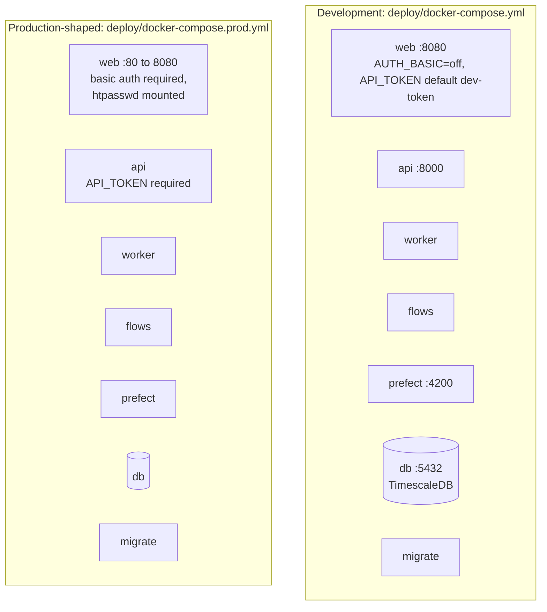
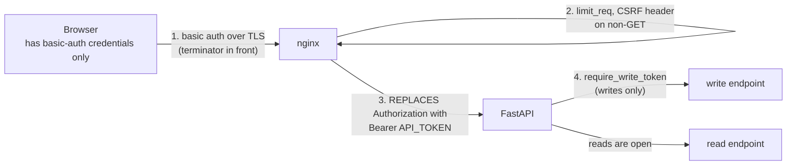
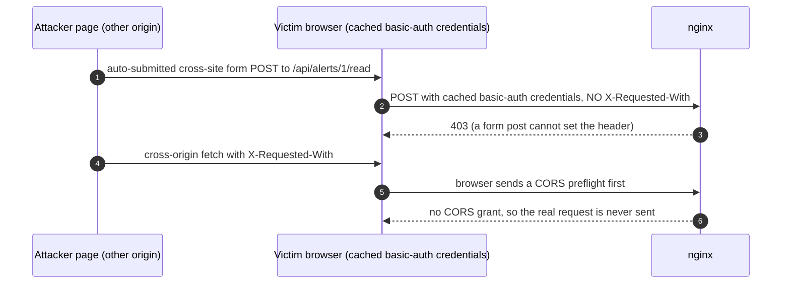
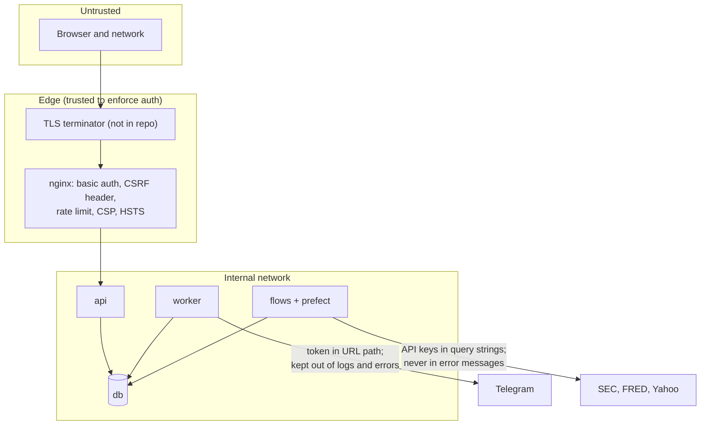
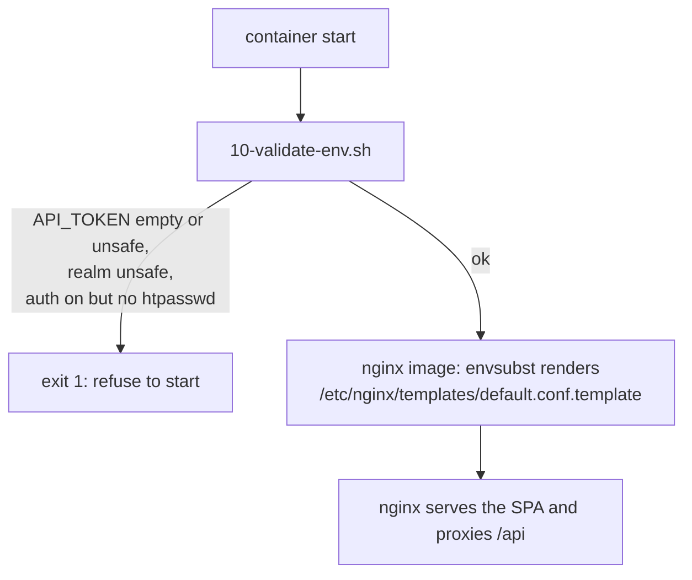

# 08: Deployment and security

Nothing is deployed anywhere by this repository: the images and compose files are **prepared**, so a
deployment can follow.

## Compose topologies

| | Dev | Prod-shaped |
| --- | --- | --- |
| Published ports | web 8080, api 8000, db 5432, prefect 4200, **all bound to 127.0.0.1** | web only (`80:8080`); api, db and prefect stay internal |
| Basic auth | off | required; `HTPASSWD_FILE` mounted and the container refuses to start without it |
| `API_TOKEN` | defaults to `dev-token` (well known) | required (`${API_TOKEN:?...}`) |
| Images | built from the repo | `fin-api`, `fin-flows`, `fin-web` at `${TAG}` |
| TLS | none | **a terminator must sit in front** of the web container (it speaks plain HTTP) |

Start-up order: `db`, then `migrate` (one-shot), then `api`, `worker`, `flows`; `web` after `api`.
The image tags for the Prefect server must equal the Prefect version locked in `uv.lock`
(`flows/tests/test_versions.py` enforces it). All images run as a non-root user.

## The authentication chain

## Trust boundaries and where secrets live

| Secret | Where it is used | Rule |
| --- | --- | --- |
| `API_TOKEN` | api (checks it) and web (adds it) | URL-safe only (`openssl rand -hex 32`): it lands in a quoted nginx string, and the entrypoint validator rejects `"`, `;`, `$`, whitespace and similar. Never in browser code. |
| htpasswd file | web | Mounted read-only; bcrypt (`htpasswd -B`). A missing or empty file stops the container. |
| `TELEGRAM_BOT_TOKEN`, `TELEGRAM_CHAT_ID` | worker | Required only when the flag is on; the token never appears in errors or logs. |
| `FRED_API_KEY`, `SEC_USER_AGENT` | flows | Provider errors never contain credentials. |
| Database credentials | all Python containers | `DATABASE_URL` or `POSTGRES_*`; the API reports only the exception type on failures. |

## Web container start-up

## What has and has not been verified

Run for real: the rendered template against **nginx 1.24** (config validity, 401/200, token injection,
CSRF header, headers, rate limit, fail-closed, `auth_basic off`) and the validator script, plus the built
UI driven through that nginx in Chromium. **Not run:** the Alpine image build and its entrypoint wiring
(no Docker daemon in the build sandbox; checks are in `scripts/smoke-images.sh`), and nginx 1.27.
