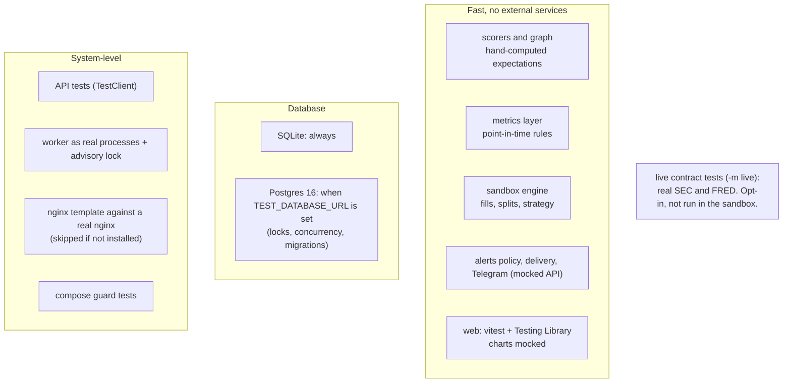
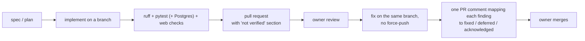

# 09: Quality and tooling

## Test layers



Postgres variants are parametrised through the `raw_engine` fixture (`postgres` marker). SQLite does not
enforce column types or lengths, so DB-touching changes must also run on Postgres.

## Local commands (CI is disabled)

```sh
uv run ruff check . && uv run ruff format --check .
uv run pytest -q
TEST_DATABASE_URL=postgresql+psycopg://user@localhost:5432/fin_test uv run pytest
(cd apps/web && pnpm typecheck && pnpm test && pnpm build)
docker compose -f deploy/docker-compose.yml config -q
scripts/smoke-images.sh          # needs Docker
```

## Review loop used for every PR



## CI/CD (deferred)

`.github/workflows/ci.yml` (path-filtered lint, tests, image build, non-root check, Trivy, compose
validation) and `release.yml` (Commitizen release) exist but are manual-only. The TODO list at the top
of `ci.yml` names what to fix before re-enabling: an unresolvable Trivy action version, double triggers
per push, and missing path filters.
