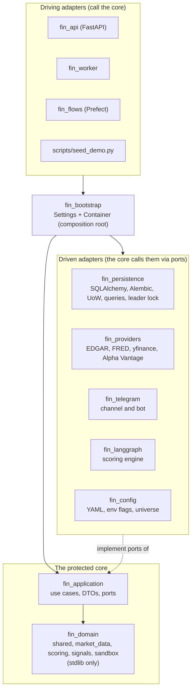

# 10: Hexagonal architecture

The backend is split into a **protected core** (domain and application) and adapters around it.
The boundary is enforced by the build, not by convention (see "How the core is protected").

## Dependency rule

`fin_domain <- fin_application <- adapters <- fin_bootstrap <- apps`. Arrows only point inward.
Adapters never import each other. Apps reach adapters only through `fin_bootstrap` (it re-exports
`FeatureFlags`).

## Bounded contexts

Contexts reference each other by `Ticker`, never by database id, and depend in one direction:
`sandbox > signals > scoring > market_data > shared`.

| Context | Owns | Notable pure rules |
| --- | --- | --- |
| `shared` | `Ticker`, `JobRun`, errors, events, UTC helpers | A run is `failed` until it completes; naive datetimes are rejected. |
| `market_data` | `Security`, `Fact`, `PriceBar`, concepts | Point-in-time facts, fiscal-year series, restatement check, candle aggregation. |
| `scoring` | `SecurityMetrics`, `ScoreResult`, philosophies, guardrails | Abstention, guardrail veto cap, `calculate_metrics`, `assess`. |
| `signals` | `Signal`, `Alert`, `Delivery`, `ScoreEntry`, alert policy | `decide_signal` (70/50, hysteresis 65/55), cooldown, delivery claim and backoff. |
| `sandbox` | `Portfolio`, `Order`, `StrategyRules`, `PriceBook` | Next-bar fill, sells before buys, average-cost holdings. |

## Ports

Ports are Protocols in `fin_application.ports`; the domain has none (aggregates take plain data and
`now`, never a repository).

| Port | Implemented by |
| --- | --- |
| `UnitOfWork` and its repositories and read-side queries | `fin_persistence.SqlUnitOfWork`, `fin_testkit` fakes |
| `FundamentalsSource`, `PriceSource`, `YieldSource` | `fin_providers` |
| `AlertChannel` | `InAppChannel` (application), `fin_telegram.TelegramChannel` |
| `ScoringEngine` | `fin_langgraph.LangGraphScoringEngine` |
| Config and universe providers | `fin_config` |
| `Clock`, `SingleInstanceGuard` | `fin_bootstrap.clock`, `fin_persistence.PgAdvisoryLeaderLock` |

Concurrency without leaking SQL: a delivery is claimed with an optimistic version check
(`save_delivery(expected_attempts=...)` raises `ConcurrencyConflict`); a portfolio is locked through
the repository. A database failure reaches the apps as an application error, never as a SQLAlchemy one: a lost or refused connection is `StorageUnavailable` (HTTP 503), any other database error (a constraint violation, a missing table) is `StorageError` (HTTP 500). The adapter logs the original first, because it can hold SQL and connection details that must not reach a caller: one WARNING line for an outage (it repeats for every probe), the full traceback for a `StorageError`.

## How the core is protected

1. `fin_domain` and `fin_application` declare no third-party dependencies, so
   `uv sync --package fin-application` has no SQLAlchemy, httpx or pandas.
2. `packages/domain/tests/test_core_isolation.py` checks the dependency metadata and the imports of
   the core source.
3. import-linter (`uv run lint-imports`) enforces eight contracts: layers, independent adapters, apps
   only through `fin_bootstrap`, no framework/driver/I/O module in the core, domain independent of
   application and adapters, the context chain, apps without the database driver, production code
   without `fin_testkit`.
4. ruff: banned imports and `DTZ` (no naive or implicit clocks).

## Where to add things

| To add | Do this |
| --- | --- |
| A philosophy | Pure function in `fin_domain.scoring.philosophies`, register it, thresholds and a weight in `config/philosophies.yml`; the LangGraph node in `fin_langgraph`. |
| A provider | Implement the port in `fin_providers`, build it in `fin_bootstrap.Container`. |
| An alert channel | Implement `AlertChannel` in a new adapter, register it in `fin_bootstrap.channels`. |
| A use case | Class in `fin_application`, tested against `fin_testkit` fakes, exposed as a `Container` property, called from an app. |
| A table | Model in `fin_persistence.tables`, a new Alembic revision, repository method, contract test on memory, SQLite and Postgres. |
