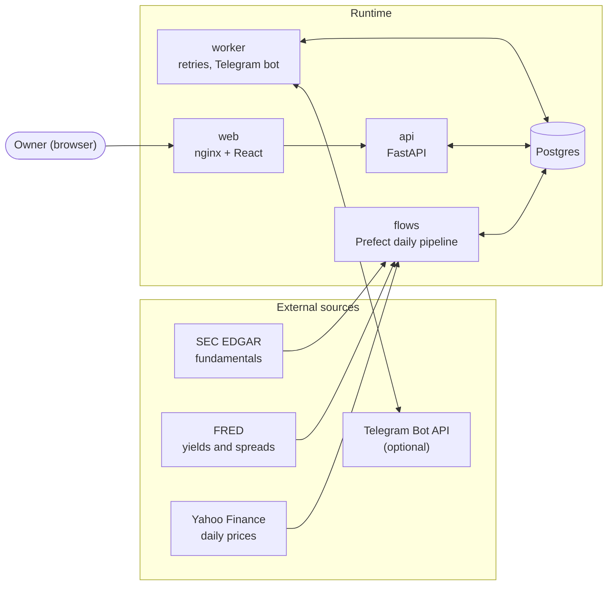

# Architecture

End-to-end diagrams of the repository. They are [Mermaid](https://mermaid.js.org/) and render on
GitHub. Read them in order for a tour, or jump to the one you need.

| # | Document | Answers |
| --- | --- | --- |
| 01 | [System context](01-system-context.md) | Who and what talks to whom: users, containers, external data sources. |
| 02 | [Repository map](02-repository-map.md) | Where things live and which package depends on which. |
| 03 | [Data model](03-data-model.md) | Tables, keys and the point-in-time rules. |
| 04 | [Data pipeline and scoring](04-data-pipeline-and-scoring.md) | The daily flow, metrics, and the LangGraph scoring graph. |
| 05 | [Signals and alerts](05-signals-and-alerts.md) | The signal state machine, hysteresis, delivery and Telegram. |
| 06 | [Paper-trading sandbox](06-sandbox.md) | Order lifecycle, fill model, strategy, holdings derivation. |
| 07 | [API and web UI](07-api-and-web.md) | Endpoints, the React app's structure and data flow. |
| 08 | [Deployment and security](08-deployment-and-security.md) | Compose topologies, the auth chain, trust boundaries. |
| 09 | [Quality and tooling](09-quality-and-tooling.md) | How the code is checked: test layers, local commands, what CI would do. |

## The system in one picture

## Reading guide

- **Shared core.** Almost all logic is in the `fin_core` library; the API, the worker and the flows
  are thin shells around it. See [02](02-repository-map.md).
- **Two data directions.** Ingestion writes facts, prices and yields; scoring reads them
  *point-in-time* and writes scores, signals, alerts and sandbox state. See [04](04-data-pipeline-and-scoring.md).
- **Honesty is structural.** Missing data is `None` with a warning, a scorer can abstain, a blocked
  run never becomes a baseline, and unverified integrations are labelled. The diagrams mark the
  places where this matters.

## Keeping these current

When a spec ([`../specs`](../specs/README.md)) changes a component, update the matching diagram in the
same PR. `CLAUDE.md` at the repository root is the dense reference; these files are the picture.
