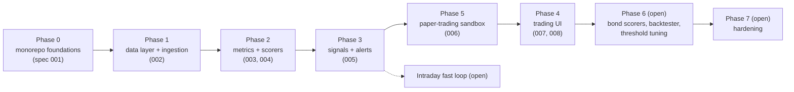

# 000: Vision, stack decisions and roadmap

- **Phase / PR:** all phases; no single PR (the plan behind PRs #10 to #17)
- **Status:** Roadmap. Phases 0 to 5 delivered; phases 6 and 7 and the intraday loop open.

## Context

The goal is an **investment opportunity scanner for US stocks and bonds** that surfaces opportunities
quickly, explains why, and lets the user see what following the signals would have done. Two older
repositories existed: `fin_app` (a Streamlit stub) and `fin_app_backend` (a Kedro pipeline with
yfinance data and a Graham-style scorer, with committed MLflow runs). The plan replaced both with a
single repository built in phases.

The product requirements came from the user's answers to design questions:

| Question | Answer |
| --- | --- |
| How fast should alerts be? | Near real time (minutes). Batch scoring first, an intraday fast loop later. |
| Where do alerts go? | An in-app feed always; a Telegram bot as an optional channel. |
| Which instruments? | US stocks plus US Treasury and corporate yields (bonds as ETFs and FRED series). |
| What should the system do with a signal? | Alert only. No real trading. A **paper-trading sandbox** simulates it. |
| Sell alerts? | Only for stocks on the watchlist. |
| Greenblatt? | Absolute thresholds per stock, not the original cross-sectional ranking. |
| Fisher's missing R&D? | Fails as "no data" rather than being skipped. |

## Decisions

1. **React instead of Streamlit.** The UI is for someone trading stocks and bonds: dense tables,
   charts, order tickets, live-ish data. A real front-end framework fits that better than Streamlit.
   Chosen: Vite + React + TypeScript (see spec 008 for the stack).
2. **Drop Kedro; keep Prefect; add LangGraph.** The owner wanted to get rid of Kedro and asked for
   alternatives; the outcome was to keep Prefect for scheduling and run tracking.
   Scoring is a **LangGraph** graph where each investment philosophy is a node, so a deterministic
   scorer can later be swapped for an LLM-agent node (`impl: deterministic | llm` in
   `config/philosophies.yml`) without touching the wiring.
3. **One monorepo** (`uv` workspace for Python, `pnpm` for the web app): `packages/core`
   (`fin_core`), `apps/api`, `flows`, `apps/web`, plus `deploy/`, `config/`, `scripts/`.
4. **Telegram is built but feature-flagged off.** `FEATURE_TELEGRAM_ENABLED` defaults to false; off
   means no client, no token needed and zero network calls.
5. **Deployment is prepared, not performed.** Dockerfiles, a dev compose file and a prod-shaped
   compose template exist; nothing is deployed anywhere by this repository.
6. **A sandbox for "what if I had followed the signals"** (for example $100 at the start): simulated
   portfolios, with manual and signal-driven modes. Specified in 006.
7. **Everything is tested locally; CI is deferred.** GitHub Actions workflows were disabled
   (manual runs only) on the owner's request; the local equivalents are listed at the top of
   `.github/workflows/ci.yml` and in `CLAUDE.md`.
8. **Honest limits are part of the design.** Missing data stays `None` and is explained; a scorer
   may abstain; no conviction is better than a fake zero; unverified integrations are labelled.

## Roadmap

Phase 5 (sandbox) was deliberately built before Phase 4 (UI) because the UI's most useful screens
(portfolio, order ticket) need it.

## Acceptance (for the roadmap as a whole)

Phases 0 to 5 are delivered and merged (PRs #10 to #17). The open items are listed in the
[backlog](README.md#not-specified-yet-backlog).
